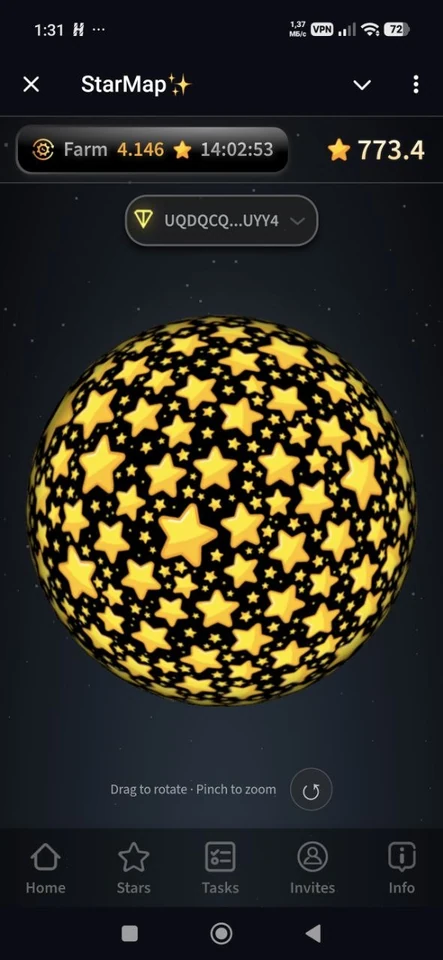

# StarMap - Telegram Mini App

Автор проекта - **Евгений Толмачев**. [Профиль GitHub](https://github.com/EvgenyET) · [Проект в портфолио](https://evgeny-dev.pro/project/StarMap_app/starmap_telegram_app.html)

Игра в Telegram с интерактивной 3D-планетой из звёзд. Выбор и покупка звезды за Telegram Stars, личная коллекция, фарминг Star Points и реферальные награды.

## Задача проекта

Проект соединяет 3D-интерфейс с состоянием пользователя и серверной обработкой платежей. На мобильном экране особенно важно различать нажатие, вращение и масштабирование, а покупку завершать по подтверждённому платёжному событию. Telegram-версия является отдельным приложением экосистемы StarMap.

## Мой вклад

Разработал визуальную концепцию и 3D-сцену, размещение звёзд на сфере, выбор объекта и управление жестами. Реализовал клиентские экраны коллекции, фарминга и приглашений, связал их с серверным профилем. Добавил проверку данных запуска Telegram, обработку покупок за Stars, сохранение владения в MySQL и подключение TON-кошелька.

## Интерфейс

| Звёздная планета в Telegram Mini App | Приближение отдельных звёзд на карте |
|:---:|:---:|
|  |  |

## Как работает приложение

StarMap превращает коллекцию звёзд в интерактивную трёхмерную карту внутри Telegram. Игрок вращает планету, приближает участок поверхности и выбирает отдельную звезду. Её карточка открывает сценарий покупки за Telegram Stars, после подтверждения сервер сохраняет владельца и обновляет коллекцию. Дополнительный игровой цикл объединяет фарминг Star Points, задания, приглашения и рейтинг.

## Возможности

- Трёхмерная планета с вращением, приближением и выбором конкретной звезды.
- Карточка звезды и покупка за Telegram Stars с серверным подтверждением.
- Личная коллекция и обновление состояния приобретённых звёзд на карте.
- Фарминг Star Points по таймеру, задания и рейтинг игроков.
- Приглашения друзей и учёт реферальных наград.
- Подключение TON-кошелька через TonConnect.
- Обработка касаний и жестов с отдельными сценариями выбора и перемещения.

## Техническое устройство

### Отрисовка и выбор звезды

Three.js размещает звёзды на поверхности сферы. InstancedMesh позволяет рисовать множество объектов одной геометрии вместе. Raycaster проводит луч от точки касания через сцену и находит выбранную звезду.

### Управление на телефоне

Обработчик жестов различает касание, перетаскивание и масштабирование. Поэтому карту можно вращать, не открывая случайно карточку звезды. Отдельное управление возвращает исходный вид планеты.

### Профиль и прогресс

Клиент получает с сервера состояние игрока и обновляет экраны фарминга, коллекции и приглашений. Реферальная связь сохраняется между запусками мини-приложения.

### Авторизация и покупка

Сервер проверяет подпись и срок действия данных запуска Telegram. Покупка связана с платёжной записью и подтверждением Telegram Stars. Уникальный идентификатор платежа и проверки состояния помогают обрабатывать повторные уведомления, а MySQL хранит покупку и владельца звезды.

## Технологии

| Технология | Роль в проекте |
| --- | --- |
| Three.js и WebGL | Трёхмерная сцена, материалы, подсветка и выбор отдельных звёзд на планете. |
| Telegram Mini Apps и Telegram Payments | Запуск игры в Telegram, авторизация игрока и оплата звёзд внутри приложения. |
| TonConnect | Подключение TON-кошелька из профиля игрока. |
| JavaScript, Webpack, Babel и SASS | Сборка клиента и оформление мобильных экранов, игровых панелей и переходов. |
| Node.js, Express и MySQL | REST API для игрового прогресса, проверка запросов, хранение коллекций и истории покупок. |
| Nginx и PM2 | HTTPS и проксирование запросов к API, управление серверным процессом и его перезапуск. |

## Демонстрация

На странице портфолио доступны описание, галерея и видеодемонстрация проекта. [Открыть StarMap - Telegram Mini App](https://evgeny-dev.pro/project/StarMap_app/starmap_telegram_app.html).
