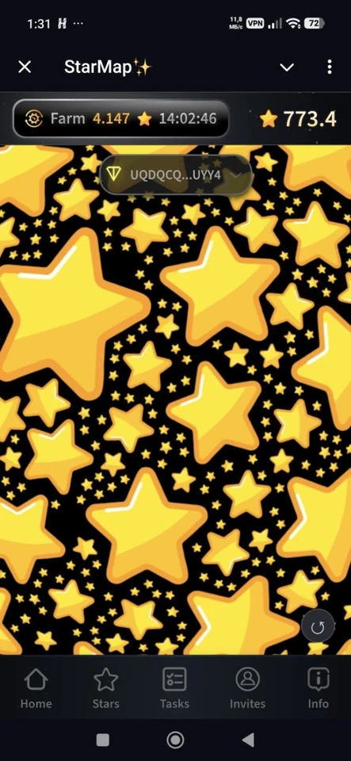

# StarMap - Telegram Mini App

**Автор проекта:** [Евгений Толмачев](https://github.com/EvgenyET) · [Страница проекта в портфолио](https://evgeny-dev.pro/project/StarMap_app/starmap_telegram_app.html)

Интерактивная карта звёзд в Telegram с коллекцией, фармингом Star Points, заданиями и приглашениями.

## Мой вклад

Разработал фирменный стиль StarMap, трёхмерную сцену и анимации для Telegram. Реализовал выбор отдельной звезды на вращающейся планете и управление жестами, чтобы нажатие открывало карточку, а перетаскивание поворачивало сферу.

## Интерфейс

| Звёздная планета в Telegram Mini App | Приближение отдельных звёзд на карте |
|:---:|:---:|
|  |  |

## Как это работает

Игрок вращает карту, приближает звезду и открывает её карточку. Из мини-приложения доступны коллекция, задания, реферальная программа, покупка звёзд и подключение TON-кошелька.

## Возможности

- Вращение и масштабирование трёхмерной карты, выбор звезды.
- Коллекция, фарминг, задания и учёт приглашений.
- Покупки через Telegram Stars и подключение TON-кошелька.

## Технологии

- **Three.js и WebGL** - Интерактивное трёхмерное представление карты.
- **Telegram Mini Apps** - Контекст пользователя и запуск приложения.
- **TON Connect** - Связь с кошельком игрока.

## О проекте

Первые версии карты появились весной 2025 года. В портфолио Telegram-версия отнесена к августу 2026 года, когда началась активная доработка интерфейса и игровых сценариев.

Коммерческий проект. Исходный код закрыт.
